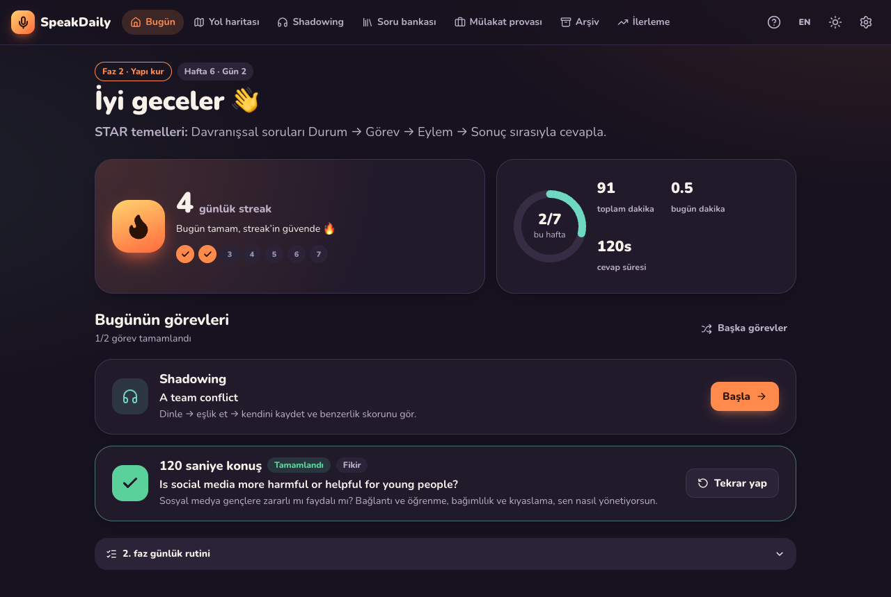
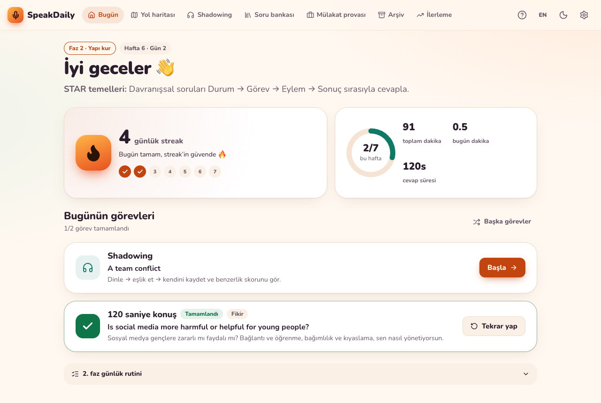
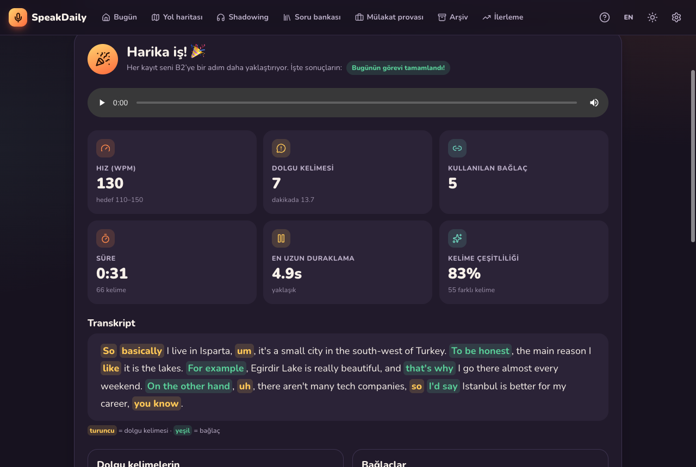
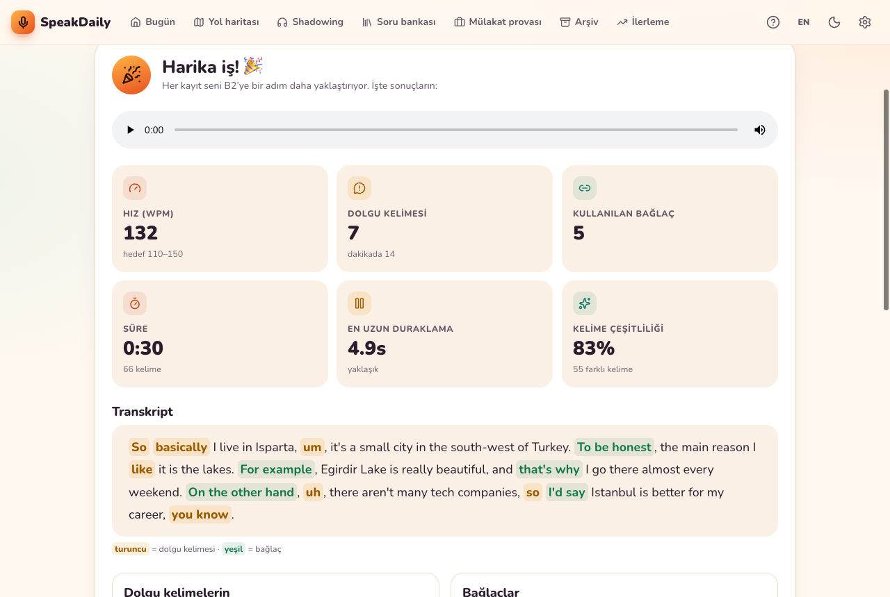
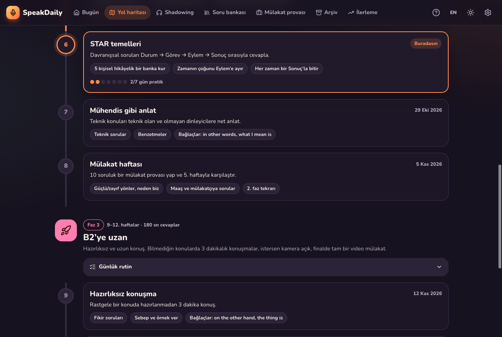
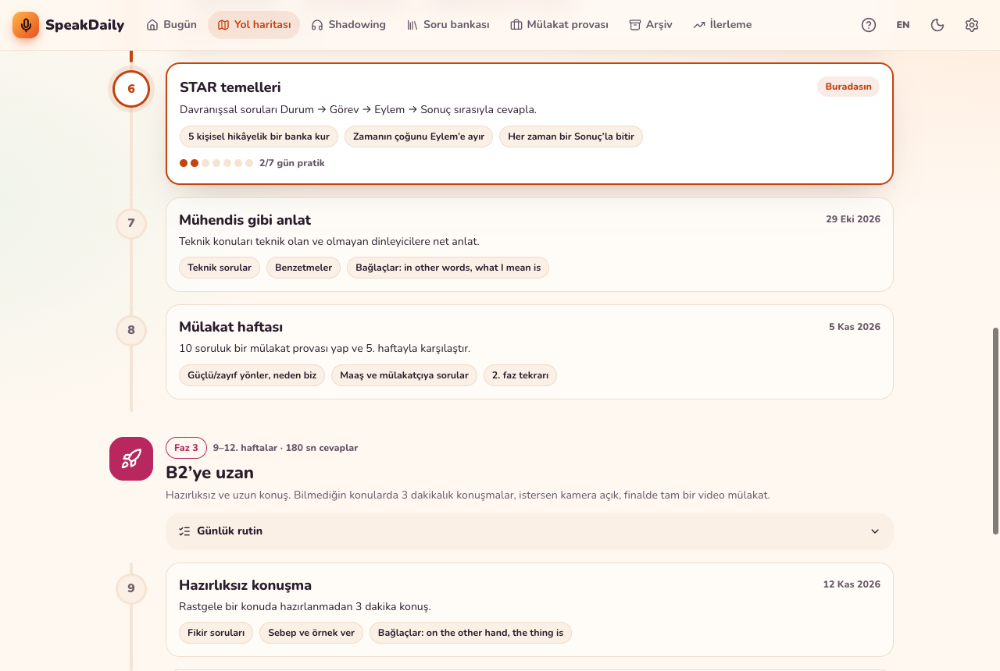
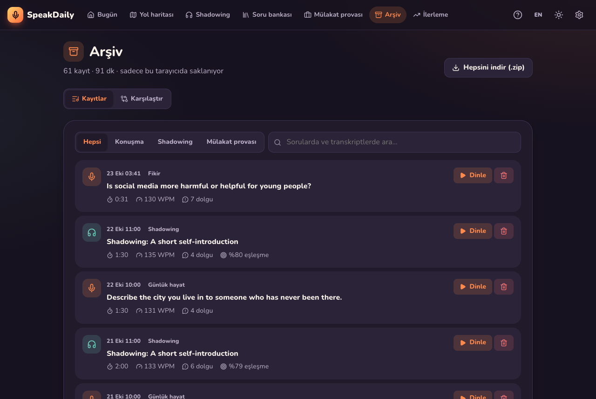
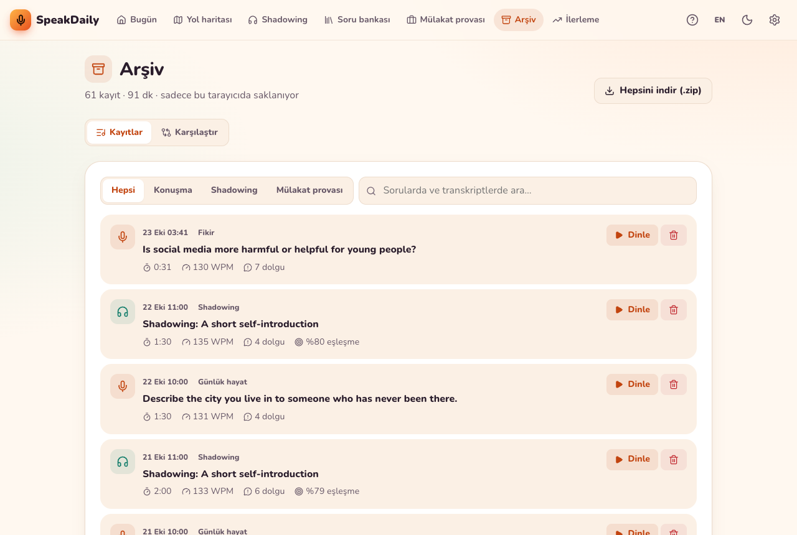
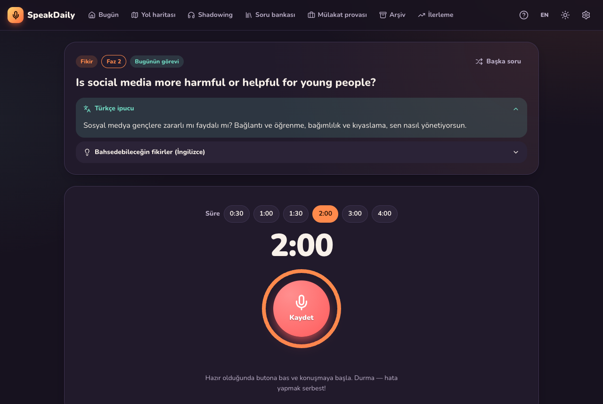

# 🎙️ SpeakDaily

**A personal English speaking trainer for a 12-week, interview-focused B1 → B2 program.**
Every day it gives you a shadowing exercise and a speaking prompt that fit your week of the program. You record yourself and see a live transcript, then get instant stats: pace, filler words, pauses, connectors and vocabulary variety. Every recording is archived, so you can hear how you've improved.

No backend, no account. Everything (including audio) stays in your browser.

> Built with React 19, Vite, TypeScript (strict), IndexedDB, MediaRecorder and the Web Speech API.

**Live demo:** https://speakdaily-coral.vercel.app

---

## Screenshots

The interface is in **Turkish by default** (switchable to English); the practice content stays in English.

| | Dark (default) | Light |
| --- | --- | --- |
| **Today** |  |  |
| **Recorder result** |  |  |
| **Roadmap** |  |  |
| **Archive** |  |  |

<details>
<summary>Recorder before you start</summary>



</details>

---

## Features

### 🇹🇷 Turkish interface, English practice
- The whole UI is in **Turkish** by default (informal *sen* form), with an **EN/TR toggle** in the header and in Settings.
- The things you read aloud or answer stay in **English**: prompts, STAR questions, shadowing passages and the filler/connector word lists.
- Learning aids in Turkish:
  - a one-line **`hintTr`** under every prompt, explaining what the question asks and what to mention (collapsible, with a global "show Turkish hints" switch)
  - a Turkish **summary** before each shadowing passage
  - a Turkish **meaning** next to every connector phrase
- A **"Nasıl çalışır?"** page explains the program, the daily routine, each screen and the key terms (WPM, STAR, streak, shadowing).

### 📘 Vocabulary units (learn → listen → practise → speak)
- **12 units, one per week, 180 chunks.** Units progress from A2/B1 ("major in", "in my free time") to B2 interview language ("take responsibility", "a good fit for this role"). Each unit has 15 words, collocations and connectors, each with a Turkish meaning, an example sentence and its Turkish translation. All 14 tracked connectors are spread across the units.
- **The method:**
  1. **Learn:** cards for each chunk, with audio.
  2. **Listen:** a short model text that uses the chunks. Hover any word to hear it.
  3. **Practise:** 30 retrieval questions. You first recognise the meaning (or listen and pick), then choose the right chunk to fill a gap in a sentence. Mistakes come back at the end.
  4. **Speak:** a recorded answer with target chunks. The transcript is checked for which ones you actually used.
- **Spaced repetition** uses Leitner boxes with reviews after 1, 3, 7, 14 and 30 days. Questions get harder as a chunk climbs the boxes: recognise → choose in context → **type it from the Turkish**, with tolerance for small typos.
- **The "use it" loop:** every speaking task shows a few target chunks from your current unit. Chunks you say in your own speech are detected, including inflected forms like "took responsibility" or "applying for", and promoted in the review schedule.
- **Today** starts with *Vocabulary review* and *your current unit*, followed by shadowing and speaking.

### 📅 12-week program and roadmap
- Set a start date once; the app works out your current **week, day and phase**.
- Every week has a goal and focus points, and each phase has its own daily routine checklist.
- Shows how many days you practised in each week.

### ✅ Today screen
- **Shadowing passage**, a **speaking prompt** sized to your phase (60 s, 120 s or 180 s), and in phases 2–3 a **STAR question** every other day.
- **Weekly mock interview** on day 7 of each week from phase 2 on. Week 12 ends with a full mock **video** interview.
- Daily tasks are deterministic (seeded by your start date), so they don't change on reload, and they don't repeat within a phase. You can still shuffle them.
- **Streak** counter and **total minutes spoken**.

### 🎙️ Recorder
- Countdown timer with auto-stop (the limit can be changed per answer), a big record button, and a **live transcript** (SpeechRecognition, `en-US`, continuous and interim results, restarts itself when Chrome ends a session).
- Optional **camera** recording in phase 3 and in mock interviews.
- Instant analysis:
  - word count and **words per minute**
  - **filler words** (um, uh, like, you know, basically, actually, so, I mean, kind of, sort of — editable), highlighted in the transcript
  - **longest pause**, approximated from the gaps between speech-recognition events
  - **B2 connector phrases** you used, plus 3 unused ones to try next time
  - **vocabulary variety** (unique words ÷ total words)
  - short rule-based tips
- **Record again** keeps every attempt, and lists your earlier attempts at the same prompt.

### 🎧 Shadowing
- 32 interview- and workplace-themed passages (54–70 words each).
- Listen → speak along → record. Text-to-speech runs at **0.7×–1.2×** with a choice of voice and highlights the current word.
- A **word-match score** (LCS alignment that ignores case and punctuation) shows the words you missed and what the recogniser heard instead.

### 📚 Question bank
- **124 prompts** in [`src/data/prompts.ts`](src/data/prompts.ts), each with a category, phase, suggested time and 3 hint bullets.
- Categories: `interview`, `tech`, `daily`, `opinion`, `star`. Written for a computer-science student in Turkey preparing for corporate (telecom / tech) interviews.
- Filter by category and phase, search, pick a random prompt, and see how many times you've practised each one.

### 💼 Mock interview
- 5 or 10 random interview and STAR questions, one at a time, each with a timer (optionally on camera).
- Saved as a **session**, with a summary at the end: per-question stats, totals and playback. Past sessions can be reopened.

### 📈 Archive and progress
- Every recording with its date, prompt, duration, WPM and filler count, plus an audio/video player, search, filters and delete.
- **Export everything as a .zip** (audio files, `transcript.txt` per recording, and `recordings.json`).
- **Compare** two attempts at the same prompt side by side; the better value in each row is highlighted.
- Charts (Recharts): WPM over time with a target band, fillers per minute over time, minutes per week, and a **12-week practice heatmap**.

### ⚙️ Settings
- Start date, time-limit override, editable filler list, recognition language locked to `en-US`, interface language (TR/EN), Turkish hints on or off, dark/light theme (dark by default).
- Shows storage usage and lets you request **persistent storage**, so the browser won't evict months of recordings.
- **Clear all data**, with a confirmation step.

---

## The 12-week program

| Phase | Weeks | Name | Answer length | Daily routine |
| --- | --- | --- | --- | --- |
| 1 | 1–4 | **Open your mouth** | 60 s | Shadow one passage · answer one prompt without stopping · look at your fillers · re-record once |
| 2 | 5–8 | **Structure** | 2–3 min | Shadow at 1.0× · clear opening / points / conclusion · STAR question every other day · 3+ connectors · 10-question mock interview each week |
| 3 | 9–12 | **Push to B2** | 3 min | Shadow at 1.1–1.2× · random unseen topics · STAR on camera (optional) · compare with old recordings · final full mock video interview |

| Week | Focus | Goal |
| --- | --- | --- |
| 1 | Break the ice | Record every day; finish 60 s without stopping |
| 2 | Talk about you | A fluent 60-second "Tell me about yourself" |
| 3 | Fewer fillers | Replace "um / uh" with a short silent pause |
| 4 | Keep the flow | ~110+ WPM on familiar topics, < 4 fillers/min |
| 5 | Opening and closing | Every answer has a one-sentence opening and conclusion |
| 6 | STAR basics | Behavioural answers in Situation → Task → Action → Result |
| 7 | Explain like an engineer | Explain tech clearly to technical and non-technical listeners |
| 8 | Mock interview week | A 10-question mock; compare with week 5 |
| 9 | Spontaneous speaking | 3 minutes on a random topic, no preparation |
| 10 | Camera on | Check eye contact, posture and pace |
| 11 | Pressure test | Design questions, pitches, disagreements, calmly |
| 12 | Final interview | Full mock video interview; compare with your week-1 recordings |

---

## Getting started

```bash
npm install
npm run dev        # http://localhost:5173/speakdaily/
npm test           # unit tests (Vitest)
npm run lint       # oxlint, warnings fail the run
npm run build      # type-check + production build into dist/
npm run preview    # serve the production build
```

**Browser:** use **Google Chrome** (desktop or Android). Live transcription relies on the Web Speech API, which Chrome supports best. In Chrome it sends audio to Google's speech service, so it needs an internet connection. Other browsers can still record and play back; the app tells you clearly what isn't supported. Microphone access needs `https` or `localhost`.

## Deploy on Vercel

The live demo runs on Vercel and doesn't depend on GitHub Actions.

```bash
npm i -g vercel
vercel login                              # once
vercel link --yes --project speakdaily    # once: creates/links the Vercel project
vercel --prod                             # build on Vercel and publish to production
```

- **Base path:** `vite.config.ts` uses `base: '/'` when the `VERCEL` environment variable is set (Vercel sets it in its build environment), and `/speakdaily/` otherwise for GitHub Pages. The same code works on both hosts.
- **No `vercel.json` needed:** routing uses `HashRouter`, so every screen lives after the `#` (e.g. `/#/archive`) and the server only ever serves `/`. Vercel auto-detects Vite (`npm run build` → `dist/`).
- **Automatic deploys (optional):** to deploy on every push without the CLI, connect the GitHub repo in the Vercel dashboard (Project → Settings → Git).

## Deploy (GitHub Pages)

The repo ships with [`.github/workflows/deploy.yml`](.github/workflows/deploy.yml). It lints, tests and builds on every push to `main`, then publishes `dist/` to GitHub Pages.

1. Create a GitHub repository named **`speakdaily`** (the Vite `base` in `vite.config.ts` is `/speakdaily/`; change it if you use a different name).
2. Push: `git remote add origin git@github.com:<you>/speakdaily.git && git push -u origin main`
3. On GitHub, go to **Settings → Pages → Build and deployment → Source: GitHub Actions**.
4. The next push (or **Actions → Deploy to GitHub Pages → Run workflow**) deploys to `https://<you>.github.io/speakdaily/`.

Routing uses `HashRouter`, so deep links work on GitHub Pages without a 404 fallback.

---

## Project structure

```
src/
  components/   RecorderPanel, AnalysisView, HighlightedTranscript, ComparePanel, MockSummary, …
    ui/         ProgressRing, Confetti, EmptyState, Skeleton, Switch, Disclosure, PageHeader
  data/         units.ts (12 units × 15 chunks), prompts.ts (124) + promptHintsTr.ts, passages.ts (32) + passageSummariesTr.ts,
                connectorsTr.ts, program.ts (structure only — texts live in i18n)
  i18n/         tr.ts (default, source of truth), en.ts, locale parity tests
  hooks/        useRecorder, useSpeechRecognition, useSpeechSynthesis, useRecordings, useI18n, useApp, …
  lib/
    analysis/   Analyzer interface + local rule-based analyzer (swap in an LLM later)
    vocab/      chunk matching (inflections), Leitner spaced repetition, exercise generation, typed-answer check
    db.ts       IndexedDB (idb): recordings + mock sessions
    storage.ts  localStorage: settings + daily progress log
    program.ts  week/phase calculation, deterministic daily plan
    similarity.ts  LCS word alignment for shadowing
    speech.ts   typed, auto-restarting SpeechRecognition wrapper
    …
  pages/        Today, Units, Unit, Review, Roadmap, Record, Shadowing, Questions, Mock, Archive, Progress, Settings, Help
  state/        AppProvider (settings + progress context)
```

### Internationalisation
- `src/i18n/tr.ts` is the source of truth for the dictionary shape (`Messages`). `en.ts` is typed against it, so a missing or extra key is a **compile error**.
- `src/i18n/__tests__/locales.test.ts` also checks at runtime that both locales have identical keys, array lengths and function arities, and that no string is empty.
- Components read strings as typed properties (`t.today.tasksTitle`). Strings with parameters are functions (`t.today.weekDay(6, 2)`).
- The analyzer returns **tip codes** (`{ id: 'longPause', value: 4.9 }`), not English text, so tips are translated when they're rendered. An LLM analyzer can still return free-text tips.

### Design system
- Everything is defined as CSS custom properties in `src/index.css`: a warm coral accent and a soft mint secondary, on a rich plum dark theme (the default) or a warm cream light theme. There are also spacing, radius, shadow and motion scales.
- Every text/background pair was checked against **WCAG AA (≥ 4.5:1)** in both themes.
- Nunito is self-hosted via `@fontsource-variable/nunito`, so there are no external font requests. Icons are [lucide-react](https://lucide.dev).
- Motion includes a pulsing record button, a countdown ring, confetti when a daily task is completed, skeleton loaders and page transitions. All of it is turned off under `prefers-reduced-motion`.
- It's responsive: on phones you get a bottom tab bar plus a "more" menu, and at medium widths the nav switches to icons only.

### Design notes
- **The analyzer is pluggable.** `lib/analysis` exposes an `Analyzer` interface (`analyze(input) → Promise<AnalysisResult>`). The local rule-based analyzer is the default. An API-backed analyzer (e.g. Claude feedback on content, grammar and structure) can be added with `setAnalyzer()`. If it throws, `analyzeAnswer()` falls back to the local stats, so saving never breaks.
- **Storage split.** Audio and video blobs and their transcripts go in IndexedDB. Small settings and the per-day progress log go in localStorage, so the streak and minutes on the Today screen load instantly.
- **Strict TypeScript with no `any`.** The Web Speech API isn't in the DOM typings, so `lib/speech.ts` types the parts the app uses.

## License

MIT — add a `LICENSE` file with your name before publishing.
